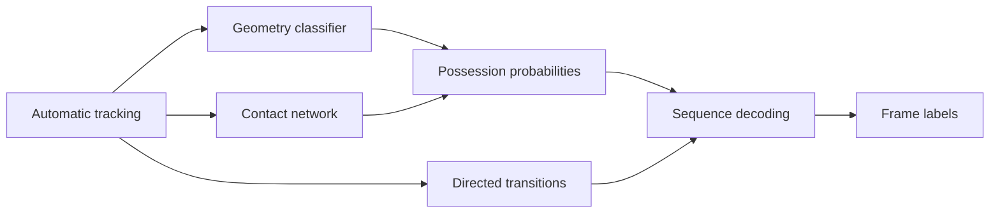

# Barca4Ever

## 1. Task and solution

### Initial Challenge technical report - V5

Barca4Ever estimates home possession, away possession and dead ball for every frame of the supplied tactical recording. V5 combines a geometry classifier, a neural contact model and a directed transition detector. CPU inference produces the 199,319-row prediction CSV.

| Item | Specification |
| --- | --- |
| Input | Tactical player and ball XY positions, plus team assignments |
| Active model | models/external_v5.joblib |
| Runtime | Python 3.12, pinned dependencies, CPU with four threads |
| Output | frame,label CSV with frames 0 through 199318 |

### From tracking to possession spells



Geometry supplies proximity, movement and visibility evidence. The contact network supplies trajectory and ball-relative evidence. Directed transitions tell the decoder which changes between home, away and dead ball are supported at each frame.

### Inputs and possession handling

The strict loader converts normalized XY into pitch-centred metres and maps source record 1 to output frame 0. It rejects missing, duplicate, reordered or malformed records and inconsistent slot counts. Player names, match identifiers, clocks and label fields are excluded from features.

| Label | Meaning and handling |
| --- | --- |
| H / A | Home or away possession, learned from external provider labels |
| D | Dead ball, learned from external ball-status labels |
| X | Abstention during a complete player-tracking outage of at least 10 seconds |

Long player outages split inference blocks. Internal ball gaps up to two seconds may be interpolated between observed endpoints. Longer gaps retain missingness. Raw observation confidence is preserved alongside filled geometry. Loose balls, deflections and restarts are represented through external H/A/D labels and directed changes.

V5 uses tactical XY tracking. Video, Smart Tagging, broadcast tracking and homography were excluded from this implementation. XY alone cannot resolve every whistle, aerial touch or ambiguous contact.

## 2. Model and training recipe

### Possession probabilities

A 59-feature histogram gradient boosting model supplies geometry probabilities. Its output is averaged equally with a neural contact branch drawing on Borghesi et al. (2023). This is our independently trained implementation with declared adaptations. The original authors' weights and confidential data were unavailable. [1]

| Component | Selected configuration |
| --- | --- |
| Geometry classifier | 200 iterations, 23 leaves, learning rate 0.07, L2 3, minimum leaf 60 |
| Shared trajectory encoder | Width 64, 1x1 stem, six kernel-2 causal blocks, dilations 1/2/4/8/16/32, dropout 0.1, batch normalization |
| Contact branches | Ball-query attention and ELU layers 64/32 |
| Neural inputs | 20 channels at 16 Hz, 64 samples, target index 47 |
| Probability mixture | 0.5 geometry + 0.5 neural |

The neural branches predict dead probability and conditional home probability. Joint H/A/D probabilities are [(1-dead)*home, (1-dead)*(1-home), dead]. Home loss is zero on dead labels. A target-frame MLP and distance-biased attention add contact evidence. All observed actors are retained in padded groups and missing objects are masked. Goalkeeper-role channels stay zero.

The original 17 input channels include position, motion, role flags and relative geometry. Three added channels encode raw ball visibility and time since/until an observation, capped at 10 seconds and scaled by 10. Velocities use actual elapsed source time. The 64-sample window includes 16 samples after the target, about one second. Gap-confidence features may use up to 10 seconds of future observation evidence. V5 therefore performs offline inference.

### Directed transition decoding

A second boosting model predicts background and H-to-A, H-to-D, A-to-H, A-to-D, D-to-H and D-to-A transitions. It uses 293 features from the base geometry and signed context at +/-2, 6 and 12 frames. Its configuration is 100 iterations, 11 leaves, learning rate 0.08, L2 5, minimum leaf 80 and seed 20261116. Fitting samples every fifth valid frame, with positive weight 20. Targets extend two frames around the nearest external change, with earlier ties.

Viterbi maximizes summed log possession probabilities minus the directed switch cost 16/(1+8*b[t,previous,next]). Validation selected directed weight 1. The retained older destination detector contributes zero at that setting. Boundary scores reflect weighted training evidence and are uncalibrated.

### Fitting and selection

V5 starts from the corresponding role-free checkpoint, with added input weights initialized to zero. Fine-tuning uses two epochs of 100,000 fresh references, batch 256, Adam 1e-4 with cosine decay to 3e-5 and seed 20261116. References mix 75% eligible frames and 25% uniform team spells. Spell weights are clip(sqrt(250/duration_frames),0.5,4). Clean/noisy views and home/away swaps are included.

Validation compared 16/25 Hz inputs, neural weights 0.25/0.5/0.75 and directed weights 0/0.5/1. The selected composite had the highest WR9 spellF1 among candidates passing the declared clean/noisy cross-validation and regression gates. Protocols, alternative designs and rejected trials are retained in the repository.

## 3. External evidence and limitations

### Dataset, labels and rights

The deployed V5 model was fitted on IDSSE, published by Bassek, Rein, Weber and Memmert, with original data from DFL / Sportec Solutions, under CC BY 4.0. Published provider BallPossession and BallStatus supply the references. BallStatus 0 maps to D, live possession 1/2 maps to H/A and unknown maps to X. Label fields are isolated from model inputs. These references were supplied by the provider. [2-4]

| Role | Whole matches |
| --- | --- |
| Fit, 4 matches | J03WOH, J03WOY, J03WPY, J03WQQ |
| Validation, 1 match | J03WR9 |
| Reused regression, 2 matches | J03WMX, J03WN1 |

All seven matches have appeared in development. Cross-validation fits WOH/WOY and evaluates WPY/WQQ, then reverses. Both halves stay together. Every initializer, fine-tune, tree and transition detector excludes the evaluated whole matches from fitting.

### Matched comparisons

The exact organizer spellF1 is primary. Scores average halves equally. Short recovery counts same-team possessions shorter than two seconds matched at IoU 0.5.

| Comparison | View | V4.1 spell | V5 spell | V4.1 short | V5 short |
| --- | --- | --- | --- | --- | --- |
| Whole-match CV | Clean | 0.7105 | 0.7133 | 191/463 | 206/463 |
| Whole-match CV | Noisy | 0.5329 | 0.5344 | 79/463 | 80/463 |
| Reused regression | Clean | 0.6808 | 0.6847 | 128/362 | 132/362 |
| Reused regression | Noisy | 0.4968 | 0.5140 | 64/362 | 71/362 |

The fixed corruption adds 0.25 m player jitter, 0.35 m ball jitter, 5% player dropout and ball gaps of 15-84 source frames. Clean/noisy runs share labels. The observed gains are small and come from repeated development comparisons on one provider. They provide limited independent evidence. Competition performance awaits the organizer's private evaluation.

### What remains difficult

Noisy short possessions remain a weakness, with 80/463 recovered in cross-validation. Simulated corruption covers only part of real tracking noise. Identity switches, body orientation, aerial contacts, whistles and provider-specific possession definitions limit transfer. Exact nearest-player ties retain the trained slot-order convention. Further work would need stronger independent evaluation of contact and turnover evidence.

All fitting, selection and quality evaluation used external data. The supplied match was used for local inference. The active artifact's training data is IDSSE. Later research candidates and other datasets described in the research history were excluded from this deployed model.

## 4. Reproduction, verification and references

### Regenerate the prediction file

Run from the repository root with Python 3.12. Install the pinned CPU dependencies, then use the organizer's local data bundle containing tactical/BAR-ATH_tactical_atd.xml and tactical/BAR-ATH_tactical_atd.txt.

```text
python -m pip install -r requirements-contact.txt
python refined_infer.py --model models/external_v5.joblib --data-dir /local/bundle --out Barca4Ever.csv
python evaluation/validate_submission.py Barca4Ever.csv
```

The public repository includes the trained model, NumPy neural state, classifiers, pinned dependencies and execution instructions. The model guide contains the full training reproduction procedure. The Windows launcher verifies the artifact checksum and stores validation details locally.

### Release verification

The November 11 release passed 85 synthetic tests. A generated 199,319-frame match passed the corrected launcher, actual V5 CPU inference and the organizer's format validator. Cases included short and long ball gaps, a missing team and a long complete player outage. Timing, actor grouping, missing padding and directed decoding were checked. The earlier saved-model evidence includes four external CPU parity comparisons and historical 82-test reports.

The output manifest records model and CSV hashes. The qualified model SHA-256 is recorded with the artifact metadata. The frozen submission CSV was reproduced exactly from the published inference sources and pinned CPU dependencies. Format and synthetic checks establish software behavior and file validity. Football quality is supported only by the external comparisons above.

### Data handling

Challenge inputs, predictions, intermediates and validator logs are kept locally and excluded from the public package. Inference performs no fitting or calibration. Predictions were not checked against the supplied video or ground truth. The organizers prohibit uploading their data or extracts to hosted AI services. External data attribution must accompany trained artifacts.

### References and review links

[1] Borghesi et al. (2023), Expert Systems with Applications, article 119780. DOI 10.1016/j.eswa.2023.119780.

[2] Bassek, Rein, Weber and Memmert (2025), An integrated dataset of spatiotemporal and event data in elite soccer, Scientific Data 12, 195. DOI 10.1038/s41597-025-04505-y.

[3] IDSSE deposit, DFL / Sportec Solutions. DOI 10.6084/m9.figshare.28196177.

[4] Creative Commons Attribution 4.0. https://creativecommons.org/licenses/by/4.0/

Public code and detailed evidence https://github.com/aqaPayam/Barca4Ever
