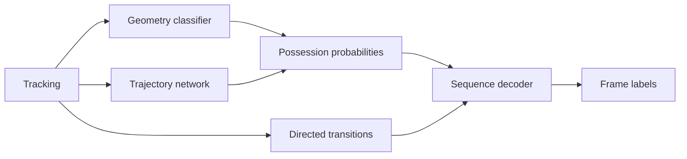

# Barca4Ever

Team possession estimation from automatic football tracking. V5 combines a geometry classifier and a trajectory network, then uses directed transition scores to decode a possession sequence. It takes player/ball positions and team assignments and writes one label per tactical-video frame.

**V5 · offline CPU inference · external development results · competition evaluation pending**

[Report (PDF)](submission/Barca4Ever.pdf) · [LaTeX source](submission/Barca4Ever.tex) · [Model guide](V5_MODEL_GUIDE.md) · [Development experiments](MULTIAGENT_RESULTS.md)

## Run V5

Use Python 3.12. Run from the repository root with the organizer's data bundle stored locally.

```text
python -m pip install -r requirements-contact.txt
python refined_infer.py --model models/external_v5.joblib --data-dir "/path/to/bundle" --out local_outputs/Barca4Ever.csv
python evaluation/validate_submission.py local_outputs/Barca4Ever.csv
```

The bundle must contain `tactical/BAR-ATH_tactical_atd.xml` and `tactical/BAR-ATH_tactical_atd.txt`. The trained model is included. CPU inference uses four threads.

On Windows, the launcher also verifies the model checksum and runs format validation.

```powershell
.\Run-Barca4Ever.ps1 -DataRoot "C:\path\to\bundle" -Output "local_outputs\Barca4Ever.csv"
```

The output has 199,319 indexed rows. Labels are `H` for home possession, `A` for away possession, `D` for dead ball and `X` for abstention during long complete player-tracking outages. The local manifest records model and output hashes.

## Method



Geometry provides spatial evidence, the network adds local trajectory and observation history, and directed transitions help place changes. The trajectory branch is inspired by contact modeling but is trained on provider possession and ball-status labels. It has no touch-level supervision. Its future context makes it an offline method. [Method and equations](submission/Barca4Ever.pdf)

## Results

These comparisons use licensed IDSSE data and the organizer's spellF1 implementation. SpellF1 matches same-team possession intervals and averages F1 over five temporal IoU thresholds from 0.3 to 0.7.

| Comparison | Tracking | V4.1 spellF1 | V5 spellF1 |
| --- | --- | --- | --- |
| Whole-match cross-validation | Clean | 0.7105 | 0.7133 |
| Whole-match cross-validation | Simulated noise | 0.5329 | 0.5344 |
| Reused regression matches | Clean | 0.6808 | 0.6847 |
| Reused regression matches | Simulated noise | 0.4968 | 0.5140 |

All seven matches have appeared in development. Evaluated matches are excluded from each fold's fitting, but the collection has been inspected repeatedly. The noisy cross-validation gain is small, and V5 recovers only **80/463 possessions shorter than two seconds** in that setting. The report gives the full split, short counts and limitations. [Report](submission/Barca4Ever.pdf) · [Experiment record](MULTIAGENT_RESULTS.md)

## Where to look

| Purpose | File |
| --- | --- |
| Start a review | [REVIEWER_GUIDE.md](REVIEWER_GUIDE.md) |
| Run the selected model | [refined_infer.py](refined_infer.py) |
| Inspect artifact and settings | [V5 artifact metadata](models/external_v5.joblib.metadata.json) |
| Reproduce training or verification | [V5_MODEL_GUIDE.md](V5_MODEL_GUIDE.md) |
| Read the report in the browser | [Barca4Ever.md](Barca4Ever.md) |

Earlier models and rejected trials are kept in the experiment history. The command above selects V5 explicitly.

## Checks and report build

```text
python -m unittest discover -s tests -v
```

The November 11 release passed 85 synthetic tests and a full-length generated-data inference/format check. These checks establish software behavior and file validity. The possession-quality evidence is the external result table above. [Software check summary](external_reports/v5_software_verification_2026_11_11.json)

The PDF is compiled from the included LaTeX source with Tectonic 0.17.0.

```text
tectonic --untrusted --outdir submission submission/Barca4Ever.tex
```

The first build may fetch standard TeX resources. [Tectonic](https://tectonic-typesetting.github.io/en-US/install.html)

## Data and license

The deployed model was trained on IDSSE, published by Bassek, Rein, Weber and Memmert (2025), with original data from DFL / Sportec Solutions, under CC BY 4.0. Changes include parsing, features, simulated corruption, model training and decoding. Preserve this attribution with trained artifacts. [Dataset](https://doi.org/10.6084/m9.figshare.28196177) · [Data paper](https://doi.org/10.1038/s41597-025-04505-y) · [Data provenance](EXTERNAL_DATA.md)

The competition starter and evaluation utilities are covered by the included MIT license. Keep organizer assets, predictions and local logs outside the public package, and follow the organizers' prohibition on uploading their data to AI services. [Code license](LICENSE) · [Competition repository](https://github.com/metrica-sports/more-than-a-hack-2027)

This project used AI assistance for coding, research and review.
