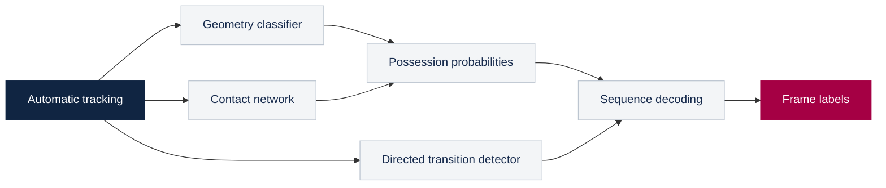

# Barca4Ever

### Team possession estimation for More Than A Hack 2027


An offline model that turns automatic player and ball tracking into a team possession label for every tactical-video frame.

| Input | Model | Output |
| --- | --- | --- |
| Player and ball XY positions, team assignments | V5 contact network, geometry classifier and directed transition decoder | A `frame,label` CSV with 199,319 rows |

[Technical report](Barca4Ever.md) · [V5 model guide](V5_MODEL_GUIDE.md) · [Development results](MULTIAGENT_RESULTS.md) · [Data provenance](EXTERNAL_DATA.md)

## Reproduce the submission

Use **Python 3.12** and the organizer's local data bundle. Run the commands from the repository root. The trained V5 artifact is included in this repository. CPU inference uses four threads.

```text
python -m pip install -r requirements-contact.txt
python refined_infer.py --model models/external_v5.joblib --data-dir "/path/to/organizer/bundle" --out local_outputs/Barca4Ever.csv
python evaluation/validate_submission.py local_outputs/Barca4Ever.csv
```

The data directory must contain these two files.

```text
bundle/
└── tactical/
    ├── BAR-ATH_tactical_atd.xml
    └── BAR-ATH_tactical_atd.txt
```

On Windows, the launcher verifies the model checksum and runs inference and format validation together.

```powershell
.\Run-Barca4Ever.ps1 -DataRoot "C:\path\to\bundle" -Output "local_outputs\Barca4Ever.csv"
```

The output manifest records the model and CSV hashes. Keep the generated CSV and intermediate files local, and upload the possession file through the organizer's submission form.

| Label | Meaning |
| --- | --- |
| `H` | Home team in possession |
| `A` | Away team in possession |
| `D` | Dead ball |
| `X` | Abstention during a long complete player-tracking outage |

## How V5 works



- **Geometry** measures proximity, motion and visibility for both teams.
- **Contact evidence** combines shared trajectory encoding, ball-query attention and raw observation confidence. Missing positions retain explicit visibility information.
- **Directed transitions** distinguish the six possible changes between home possession, away possession and dead ball.
- **Sequence decoding** combines these signals into possession spells. Source record 1 maps to output frame 0, and long player-tracking outages separate inference blocks.

The contact network draws on Borghesi et al. (2023), with our own implementation, external training and declared adaptations. The model guide documents the architecture, timing, inputs and selection procedure. [Paper](https://doi.org/10.1016/j.eswa.2023.119780) · [Implementation guide](V5_MODEL_GUIDE.md)

## External development evidence

The table uses the organizer's spellF1 metric on licensed IDSSE data. Each evaluated whole-match fold is excluded from every learned component's fitting.

| Comparison | Tracking | V4.1 spellF1 | V5 spellF1 |
| --- | --- | --- | --- |
| Whole-match cross-validation | Clean | 0.7105 | **0.7133** |
| Whole-match cross-validation | Simulated noise | 0.5329 | **0.5344** |
| Reused regression matches | Clean | 0.6808 | **0.6847** |
| Reused regression matches | Simulated noise | 0.4968 | **0.5140** |

All seven matches have appeared in development. These repeated comparisons support model selection, with limited independent evidence. Competition performance awaits the organizer's private evaluation. Short-possession counts, rejected candidates and full limitations are recorded in the technical report and development results. [Technical report](Barca4Ever.md) · [Comparison history](MULTIAGENT_RESULTS.md)

## Verification

The November 11 release passed **85 synthetic tests** and a **199,319-frame synthetic CPU run** through the Windows launcher, V5 inference and the official format validator. Checks cover time alignment, actor grouping, missing observations, directed decoding and launcher paths. These checks establish software behavior and file validity.

Run the synthetic unit suite after installing the pinned dependencies.

```text
python -m unittest discover -s tests -v
```

For a full synthetic integration check, use fresh output locations.

```text
python check_refined_pipeline.py --model models/external_v5.joblib --out local_outputs/review_pipeline.json --bundle local_outputs/review_synthetic_bundle
```

<details>
<summary>External-data parity and training reproduction</summary>

The engine parity check requires the licensed IDSSE files and prepared external caches described in the V5 model guide.

```text
python check_refined_engine.py --model models/external_v5.joblib --out local_outputs/review_engine.json
```

The checkers preserve existing reports and fixtures. Choose new output names when repeating a check.

For training reproduction, follow the V5 model guide in a fresh experiment directory. Historical reports retain their original test counts and source hashes. [Training and evaluation guide](V5_MODEL_GUIDE.md)

</details>

## Repository guide

| File | Purpose |
| --- | --- |
| [Barca4Ever.md](Barca4Ever.md) | V5 technical report for submission |
| [refined_infer.py](refined_infer.py) | Active V5 inference entry point |
| [Run-Barca4Ever.ps1](Run-Barca4Ever.ps1) | Windows launcher and format check |
| [models/external_v5.joblib](models/external_v5.joblib) | Trained submission artifact |
| [requirements-contact.txt](requirements-contact.txt) | Pinned inference dependencies |
| [V5_MODEL_GUIDE.md](V5_MODEL_GUIDE.md) | Architecture, timing and reproduction details |
| [MULTIAGENT_RESULTS.md](MULTIAGENT_RESULTS.md) | Matched comparisons and failed experiments |
| [tests/](tests/) | Synthetic software checks |

Earlier models and research evidence remain available for traceability. The commands above explicitly select V5.

## Data use and attribution

Training uses **IDSSE**, published by Bassek, Rein, Weber and Memmert (2025), with original data from **DFL / Sportec Solutions**, under **CC BY 4.0**. Changes include parsing, geometry features, simulated corruption, model training and temporal decoding. Preserve this attribution with the trained artifacts. [Dataset](https://doi.org/10.6084/m9.figshare.28196177) · [Data paper](https://doi.org/10.1038/s41597-025-04505-y) · [CC BY 4.0](https://creativecommons.org/licenses/by/4.0/)

The organizer's match assets, predictions and intermediate files stay local and are excluded from the public package. The organizers prohibit uploading their data or extracts to hosted AI services.

The competition starter code and evaluation utilities come from Metrica Sports' More Than A Hack 2027 repository under its MIT license. Team modifications and external-data provenance are described in the technical report. [Competition repository](https://github.com/metrica-sports/more-than-a-hack-2027) · [Code license](LICENSE)
